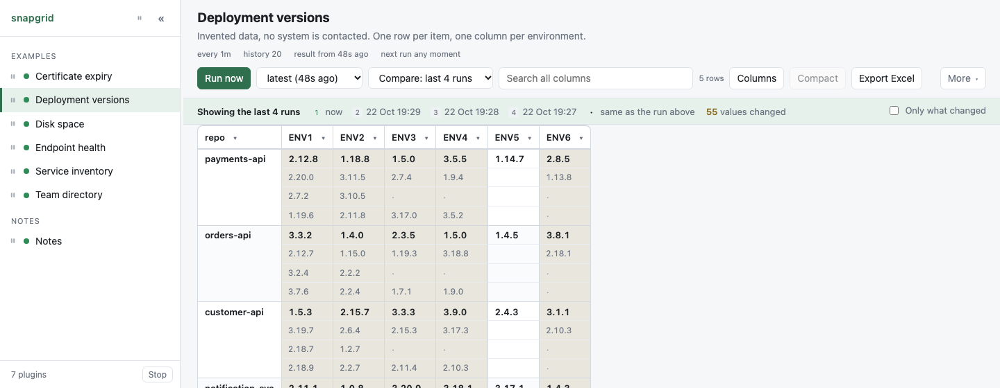

<!-- Part of the snapgrid documentation: https://github.com/NovaForge2/snapgrid -->

# The web page

**The toolbar holds what is done to this table** - Run now, which result to
show, what to compare it with, search, Export Excel - and ends with **More**,
which holds the rest: the size of the text, the theme, and the Log and Config
panels. The split is between acting on the data and setting up snapgrid, and
it is there because thirteen controls of equal weight on one line is a wall
rather than a toolbar.

**Columns** and **Clear filters** are not in it. They sit with the table,
below the comparison strip, because they are about what this table shows.

**Light or dark:** the button under **More** - `◑ auto`, `☀ light`,
`☾ dark` - cycles through the three. `auto` follows your operating system
and is the default.

The choice is remembered in your browser and is not shared with anyone else
looking at the same instance. A link carrying `?theme=dark` opens that way
whatever the machine prefers, and pressing the button still wins.

- **Left panel** - plugins grouped by `group`, with a status dot: green for a
  good run, red for a failure or a broken `plugin.toml`, blue while running.
  In front of each name is a **pause** control, and one at the head of the
  panel pauses the lot; see [Pausing a plugin](#pausing-a-plugin) below.
  The **&#171;** in its corner hides it, and the **&#187;** that appears brings
  it back; `[` does both from the keyboard. Worth it on a laptop, where 260px
  of plugin names is 260px not spent on the table.
- **Run now** runs the plugin **now**, in the background, whatever the schedule
  says. It jumps the queue ahead of anything waiting, ignores `fresh_for`, and
  ignores the slowdown after repeated failures, and runs a paused plugin -
  asking by hand means wanting new data. You can go to another plugin while it works. **Cancel** stops it,
  including anything it started, and the previous good table stays.
- **The table** does what a spreadsheet does: click a heading to sort, click the
  small arrow next to it for a checkbox list of every value in that column with
  counts, and use the search box to search everything at once. Columns holding
  only numbers sort as numbers, and columns holding only version numbers sort so
  that `2.9.0` comes before `2.14.1`.
- **Columns** chooses which columns to show. Unticking one takes it off the
  screen without taking it out of the table: filters, sorting and the search
  box still see it, and it comes straight back. The row count beside it says
  how many are hidden, and the button is highlighted while any are. **Show all** puts them
  back. The last visible column cannot be hidden - an empty table is not a view
  of anything.
- **Compact** folds rows that are identical **in the columns on screen** into
  one, with a count on the end of the row: `1 | 4 ×2`. Hiding a column often
  creates these - `1|2|4` and `1|5|4` are the same row once `B` is gone - and
  two identical lines say nothing the first one did not. The count is not
  decoration: a table claiming one of something when there are two is wrong in
  the direction that matters, so nothing is ever folded away silently. The row
  count says how many would fold while it is off, which is the only thing that
  draws the eye to the button.

  It happens **after** the filters and the search, so what folds is what is on
  screen, and **before** the sort, so the order is of the rows that remain. It
  is **not available while runs are being compared**: a folded row is not a row
  the plugin printed, it has no `[table] key`, and there is nothing to line it
  up with in an earlier run. Remembered per plugin, in your browser.
- **Column widths** are exactly the widest value in each column, so the table
  is as narrow as its contents allow and stops where they stop rather than
  being stretched across the window. Drag the edge of a heading to change one,
  and double-click that edge to let the column size itself again.

  **Only the columns you drag are remembered.** Every other column is measured
  again on each draw, so one that holds a longer value than it did last week is
  wider this week instead of clipping it with space to spare beside the table.
  A column you dragged narrow is meant to clip and is left alone: that was a
  decision, not a measurement. Widths and hidden columns are kept per plugin,
  in your browser only - **Reset widths**, in the Columns menu, forgets the
  dragged ones and fits every column to its contents again. It appears once
  there is something to forget.

  A column fits itself up to about **46 characters** and no further, because a
  column wider than that is read by scrolling rather than by looking. A value
  longer than that is clipped, with the whole of it on hover and in the cell's
  history - and dragging the column wider is honoured past the limit, since
  that is a decision about this table rather than a default.
- **Coloured values** are values a plugin has asked for a colour on, through
  `[colour]` in its manifest - red, amber, green, blue or grey. They are the
  plugin's decision, not yours, and there is nothing to switch on here; see
  [plugin-toml.md](plugin-toml.md) for how a plugin asks.
- **A&#8722; and A+**, under **More**, change the size of the text **in the
  table**, from 10px to 20px. The number between them says where you are. The browser's own zoom takes the whole page with it, including the
  panels that were already the right size; this is the grid alone, and the row
  heights and padding move with it rather than leaving a bigger font in a box
  built for a smaller one. Smaller text also means more columns at once, which
  is often the actual reason for reaching for it. The choice is remembered in
  your browser and is **not** per plugin - how big text should be is about your
  eyes and your screen, not about which table you are looking at.
**Export Excel matches the current view.** Hidden columns are excluded;
search, filters and sorting are preserved. Compact exports the displayed rows
and their counts. Comparisons include the visible stacked values and new/gone
markers. An empty filtered table exports only its column headers.

- **Export Excel** downloads an `.xlsx` with the header row frozen and bold,
  filter dropdowns, borders, banded rows and widths based on the content.
  The table is captured at click time, including when viewing an older snapshot.

  The reason to prefer the workbook is not decoration. Excel *interprets* a
  CSV as it opens it: `1.10` becomes `1.1`, so a version sorts before `1.9`;
  `0042` becomes `42`; a twenty digit account number becomes `1E+20` and the
  rest is gone. In the workbook every value is written as text unless the
  whole column is made of numbers that come back **identical** - so figures
  you might want to add up stay addable, and everything else arrives exactly
  as the plugin printed it.
- **The dropdown next to Run now picks which result is on screen.** It appears
  once there is more than one stored, and every entry says when that result is
  from and how many rows it had: `Showing 28 Oct 19:47 (latest)`, `Showing 28
  Oct 09:02 - 14 rows`. This is how you look at one earlier run on its own,
  without comparing anything. The time is a date and a clock, to the minute,
  rather than "2h ago": in a list of runs to choose between, several of them
  are "2h ago" and the minutes are the only thing telling them apart. Where two
  stored runs fall in the same minute, every entry gains its seconds. The
  dropdown is wide enough for the whole line - capped narrower, the clock is
  what got cut, which is the one part anybody picks a run by. The table, the sort, the filters, the search and the
  Excel export all then work on that result exactly as they do on the latest.
  It says `Showing` because without it a closed dropdown reads as a label
  saying when the result is from rather than as the control that changes it.
  Which result you are looking at is in the address, as `snapshot=<id>`, so the
  view can be sent to somebody.
- **The second dropdown compares runs** - see below. The two are independent:
  you can look at an earlier result and compare it with the ones before it.
- **Log** and **Config** are at the foot of the **More** menu. They open a
  panel over the right of the table, with a tab for each and a close button, so
  a panel you are not using costs the grid no space at all. Escape closes the
  menu if it is open, and the panel if it is not - one press, one thing closed.
- **Log** is the plugin's standard error, updating while it runs.
  **Following** keeps the newest line in view. Scrolling up turns it off, so
  reading something is never fought over; scrolling back to the bottom turns it
  on again. The button does the same thing deliberately, and the choice is
  remembered.
- **Config** shows what this plugin is set up to do:

  | | |
  |---|---|
  | folder | where the plugin lives, so you can go and edit it |
  | runs | the exact command, after `python` has become a real interpreter. This is the line that answers "why does it work in my terminal but not here?" |
  | .env | which variables it loads - **names only, never values**; values are opaque to the framework, so there is no encrypted badge |
  | plugin.toml | the file itself, read from disk each time you open the panel, with comments, headings, keys, strings and numbers coloured |

  It opens by itself for a plugin whose `plugin.toml` cannot be read, since the
  file is exactly what you need to see at that moment.

  This panel is not a permission boundary. Anyone who can reach the page can
  read it, and can already run the plugin and see its output, which reveals far
  more than its configuration does. Keep secrets in `.env`, never as arguments
  in `command` - arguments are visible to anyone who can list processes,
  and they would be shown here too.

## Comparing runs

<p align="center">
  <picture>
    <source media="(prefers-color-scheme: dark)" srcset="diff-dark.png">
    
  </picture>
</p>

The second dropdown chooses what to compare with, and it offers two kinds of
answer:

- **The last few runs, stacked** - **the one before**, or the **last 3, 4 or 5
  runs**. Every run in between is drawn, one line per run, which is the way to
  see *when* a value moved. Five is the most, and that is a limit of height
  rather than arithmetic: five runs of a forty row table is a very tall page.
- **One earlier run, on its own** - every stored run is listed by its date and
  clock time, `Compare with 28 Oct 09:02 - 14 rows`. That compares exactly two
  results, now and then, with nothing in between drawn. Reach is the point:
  with twenty runs kept, the run from this time last week is one choice, where
  stacking would need twenty lines in a cell and stops at five. Only differing
  results are stored, so the oldest entry in the list is the last time the
  table said something else.

It only offers as many runs as have been stored, and it is off until you ask.
Which one is chosen is in the address, as `compare=<n>` for a stack and
`against=<id>` for a single run. Moving the first dropdown to an earlier result
clears the choice, because a run named to compare with is named relative to
what is on screen.

With it on, a cell whose value moved holds one line per run, newest on top. A
cell that never moved is written once, as it always is.

Every cell used to stack, so that line two meant the same run the whole way
across. In practice most cells do not change between runs, and stacking them
all filled two thirds of the table with dots saying "nothing happened" while
burying the handful of values that did move. Reading sideways along line two
was worth less than seeing, at a glance, which cells are deep.

| What you see | What it means |
|---|---|
| a value in bold, on top | what it is now |
| a smaller, quieter value below | what it was in that earlier run |
| **a dot** | the same as the line above - this run did not move it |
| a tinted cell | something moved in that cell |
| a faint rule across the row | the line between one run and the next, drawn the whole width of the row so a value can be traced back to the run it belongs to |
| `NEW` and a green edge | the row was not there in the earlier runs |
| `GONE` and a red edge | the row is not in the current result. It is shown anyway, because a thing disappearing is worth noticing - but only if the filters and the search would have shown it, judged on the values it last had |
| `not there` | the row did not exist in that particular run |

**Nothing is struck through.** An older value was not deleted; it is just older.

**Which run is which** is written once in the strip above the table -
`1 now · 2 25 Sep 23:27 · 3 25 Sep 20:40` - because there is no room for a date
inside a cell and every cell shares the same runs. The strip says what a dot
means as well, since a dot read as "nothing there" says the opposite of what it
does say. It also counts what moved, and holds the **Only what changed** tick,
which narrows a forty row table to the rows that did something.

**What the strip counts is what is on screen.** Filter the table to ENV1 and
the count is of changes in ENV1: a strip reading "50 values changed" above nine
visible rows is a count of a table nobody is looking at. Hidden columns come
out of it for the same reason, and so do the rows a filter or the search has
taken away - including the rows that have gone, which are filtered on the
values they last had rather than put back on screen by disappearing.

**A cell that never moved is written once**, with the guides carrying on
beneath it. Blank lines there are not missing values: the one value above them
covers every run being compared. A run the row was not in at all says
`not there` instead.

**A row is only stacked when a cell on it has something to stack.** A row where
nothing moved is one line, exactly as it is with the comparison off, and so is
a row that arrived or went with no change of its own - the chip and the
coloured edge say that once, and its earlier lines would be blank. A table
where three values in forty changed is three deep rows and not forty tall ones.
A single line still opens that cell's history when it is clicked.

**Some columns are not compared at all.** A column holding the time of the run,
or a count of days remaining, is different every time the plugin runs: left in,
every row moves on every run and the answer to "what changed" is the clock.
Two ways out, and the strip above the table names the columns the first one
took out:

- `[compare] ignore` in plugin.toml, for a column that is always like that -
  see [plugin.toml](plugin-toml.md#compare-ignore).
- **Hiding the column**, for one you only want out of the way now. A hidden
  column is not compared, on the same principle: what is compared is what is
  being looked at.

**Click any value** to see the history of that one cell, which goes back as far
as the stored snapshots rather than as far as the comparison:

```
now            2.17.0
25 Sep 23:27   2.16.0
25 Sep 20:40   2.15.0
22 Sep 11:30   2.14.1
```

It will refuse one thing rather than guess it: **columns that differ between
runs**. If a run had four environments and the next had five, there is no
honest way to line the columns up, so it says so.

### Several lines under one name

Rows are matched by the column that names them - the first one, or whichever
`[table] key` names. A plugin may print several lines under one name: two pods
of one service, blue and green of one deployment. Those lines are the row's
values rather than rows of their own, so they are **merged into the row they
name**, and its cells hold a line each.

```
Environment  Service  Pod              Status   Image
SIT2         admin    admin-blue-1     Running  2.14.1
                      admin-green-7    Running  2.15.1
                      admin-green-6             2.15.0
```

Comparing marks the lines where they are, instead of the whole row arriving and
leaving:

- a value that **arrived** since the run being compared with is marked on its
  left edge,
- a value that **went** is kept on screen and struck through,
- the cell's own history, on a click, shows what the whole cell was on each
  earlier run,
- and the count under the toolbar says `4 rows - 6 lines printed`, so a key
  that merged more than expected is visible.

A filter applies inside the cell too: filtering `Status` to `Running` takes the
line that is not running out of that row's cells, and out of the tally.

A cell holding ten values is a row that should have been ten. Name what tells
the lines apart, and they stay rows of their own:

```toml
[table]
key = ["environment", "repo"]
```

## The address bar

What you are looking at is kept in the address, so a link means something to
whoever you send it to:

```
http://127.0.0.1:8765/?plugin=image-versions&compare=3&changed=1&theme=dark
http://127.0.0.1:8765/?plugin=disk-space&sort=used_percent:desc&filter.filesystem=/dev/sda1
```

| | |
|---|---|
| `plugin` | which plugin to open |
| `snapshot` | which stored result to show, by its id. Anything but this plugin's own ids is ignored |
| `compare` | how many runs to show in each cell, 1 to 5. 1 is off |
| `against` | one stored run to compare with instead, by its id - two results, now and then. Ignored unless it names a run of this plugin's that is older than the one on screen |
| `changed` | `1` to start with **Only what changed** ticked |
| `sort` | a column, and `:asc` or `:desc`. Without a direction it is ascending |
| `q` | what to put in the search box |
| `filter.<column>` | a value to allow in that column. Repeat it for each value: `filter.team=Falcon&filter.team=Heron` |
| `theme` | `light`, `dark` or `auto`, for a link that looks the same on any machine |

A column name goes in the name of the `filter` parameter rather than beside the
value, because a value can contain a comma, a colon or whatever else would
otherwise have joined them.

**What is in the address is what is about the data** - which plugin, how far
back, the sort, the search, the filters. What is about this screen stays in
this browser: the hidden columns, the dragged widths and **Compact** are one
person's view on one monitor and say nothing to whoever opens the link. The
theme button still overrides the theme in the address, and your own choice is
what is remembered afterwards.

A `sort` or a `filter` naming a column the table does not have is ignored
rather than guessed at - the link was written for another table, or for this
one before a column was renamed.

This is also how the animation at the top of the README is rebuilt instead of
being recorded by hand: every frame of it is a state this address can name.

## Pausing a plugin

Every plugin in the left panel has a small **pause** control in front of its
name. Pressing it takes that plugin off the schedule, and the control becomes a
**play** triangle for putting it back. The same control at the head of the
panel does it for all of them at once.

Neither asks for confirmation. Pausing costs nothing and the same button
undoes it.

A paused plugin keeps its place in the list, keeps the result it last
collected, and **Run now still works** - pressing it is saying so deliberately,
which is different from a timer going off. What stops is only the schedule.

It is meant for "not this fortnight": ten plugins on a machine with little to
spare, two of them worth running at the moment. If a plugin is simply too eager
rather than unwanted, raise its `[run] every` instead - that is a decision that
survives being forgotten about, and pausing is not.

Because **a paused plugin shows a table that looks exactly like a current
one**, the page says so in three places: its control is a play triangle and
coloured rather than grey, the heading carries a **Paused · Manual runs
available.** chip - hover it for how long it has been paused - and the plugin
count at the foot says how many are. Without that, a fortnight-old
number gets read as today's, which is worse than no number.

Pausing is snapgrid's own state and **does not touch `plugin.toml`**. The
plugin folder is yours, and is often a repository - snapgrid editing files in
it would turn up in somebody's `git status`. It is kept in the database beside
the plugins, which means deleting `.snapgrid` resumes everything.

`[run] every = "off"` in the manifest is the permanent version of the same
thing, and a plugin set that way is left out of Pause all - there is nothing to
pause.

## Stopping it

**Stop**, at the bottom of the left panel, stops snapgrid itself - not a
plugin, the whole thing. It asks first, because the terminal it was started
from is probably not in front of you and starting it again means finding one.

Nothing stored is lost. A plugin part way through a run is stopped, the
database is closed properly and the record of the running server is removed,
exactly as if you had pressed Ctrl+C or run `./server.py stop`. The page then
shows the command to start it again, including the explicit `--dir` needed to
reopen the same plugins and database. Startup without `--dir` is refused.

The button is in the panel's footer, away from everything used often, and it
is the only control on the page that affects the server rather than a plugin.

## Resizing

Three things can be dragged: the left panel, the Log/Config panel, and the edge
of any column heading. The two panels are dragged by the edge between them and
the table. Double-click an edge to put it back where it started, and
arrow keys move it once it has focus - shift for bigger steps. Widths are
remembered in your browser, per panel, and are not shared with anyone else
looking at the same instance.

## When nothing seems to be happening

A plugin that fails three times in a row is tried less often, doubling up to an
hour, so that one expired password does not fill the history with hundreds of
identical failures overnight.

That used to be invisible. The line under the plugin's name says so -
`slowed after 4 failures, next try in 38 min`. Two things clear it:

- **Run now**, which runs the plugin immediately whatever it is waiting for.
- **Editing `plugin.toml`**, which clears the count within seconds. Changing a
  plugin is how someone fixes a failing one, and waiting out an hour to find
  out whether it worked is no answer.

The first success puts it back to its normal interval.

**A failed run is not announced above the table.** What is on screen is the
last good result, which is still true, and a red block on top of a correct
table every time one run in fifty fails is noise. What says it instead: the dot
beside the plugin's name turns red, the line under the title says how old the
result is and when the next try is, and the **Log** panel holds the error in
full, with whatever the plugin printed before it stopped.

The one place it is still said in words is a plugin with **nothing to show at
all** - a first run that failed, so there is no table. Then the message is the
whole screen, and saying "no result yet" would read as "nothing has happened"
when what happened is that it ran and failed.
